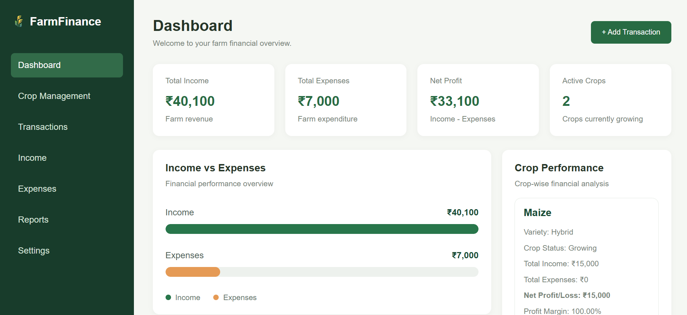
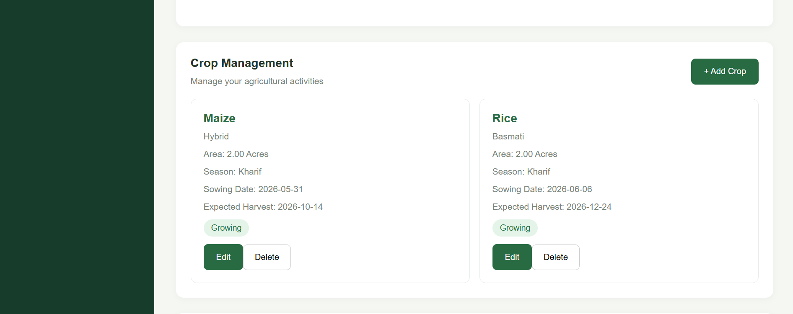
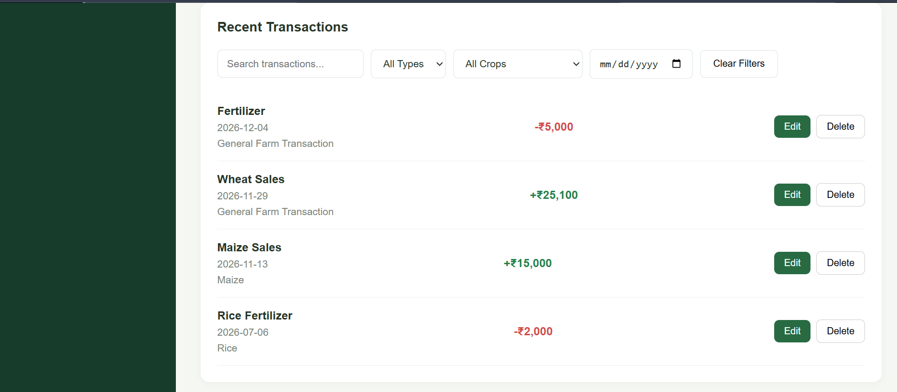
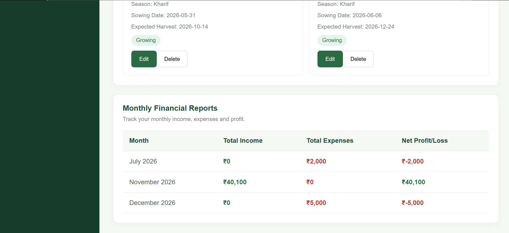

# FarmFinance – Farm Financial Management System

A full-stack web application designed to help farmers manage agricultural finances, track crop-related expenses and income, and monitor overall farm profitability.

## Features

- **Dashboard:** View total income, expenses, net profit, and active crops.
- **Transaction Management:** Add, edit, delete, search, and filter financial transactions.
- **Crop Management:** Maintain crop details, varieties, cultivation areas, seasons, and crop status.
- **Crop-wise Financial Analysis:** Track income, expenses, profit/loss, and profit margins for individual crops.
- **Profitability Comparison:** Compare financial performance across different crops.
- **Monthly Financial Reports:** Review monthly income, expenses, and net profit/loss.
- **Responsive Interface:** Access the application across different screen sizes.

## Tech Stack

**Frontend**
- React.js
- JavaScript
- CSS
- Vite

**Backend**
- Node.js
- Express.js

**Database**
- MySQL

**Tools**
- Visual Studio Code
- MySQL Workbench
- Git and GitHub

## Project Structure

```text
Farm-Financial-Management/
│
├── frontend/
│   ├── src/
│   │   ├── App.jsx
│   │   ├── App.css
│   │   └── index.css
│   └── package.json
│
├── backend/
│   ├── server.js
│   ├── .env.example
│   └── package.json
│
├── .gitignore
└── README.md
```

## Getting Started

## Database Setup

FarmFinance uses MySQL as its database.

1. Open MySQL Workbench and connect to your local MySQL server.
2. Open the `schema.sql` file from the project root folder.
3. Execute the SQL script using the lightning bolt button.
4. Refresh the Schemas panel and verify that the following tables are created:
   - `crops`
   - `transactions`

The script automatically creates the `farm_financial_management` database and establishes the relationship between crops and transactions.

### 1. Clone the Repository

```bash
git clone YOUR_GITHUB_REPOSITORY_URL
cd Farm-Financial-Management
```

### 2. Install Frontend Dependencies

```bash
cd frontend
npm install
```

### 3. Install Backend Dependencies

Open another terminal:

```bash
cd backend
npm install
```

### 4. Configure Environment Variables

Create a `.env` file inside the backend folder using `.env.example` as a reference.

Configure your MySQL database credentials.

### 5. Set Up the Database

Create a MySQL database named:

```sql
CREATE DATABASE farm_financial_management;
```

Create the required tables using the project's database schema.

### 6. Run the Application

Start the backend:

```bash
node server.js
```

Start the frontend in another terminal:

```bash
npm run dev
```

Open the local URL displayed by Vite in your browser.

## Project Objective

FarmFinance aims to simplify agricultural financial record-keeping by bringing crop management, transaction tracking, and financial reporting into one application.

---

**Project:** FarmFinance – Farm Financial Management System  
**Status:** Development and testing completed for the current feature set.


## Application Screenshots

### Dashboard


### Crop Management


### Transactions


### Monthly Financial Reports

